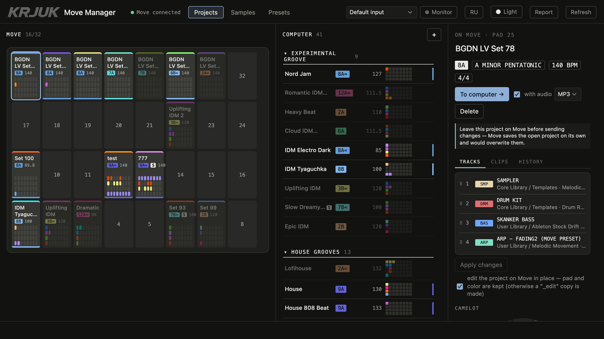
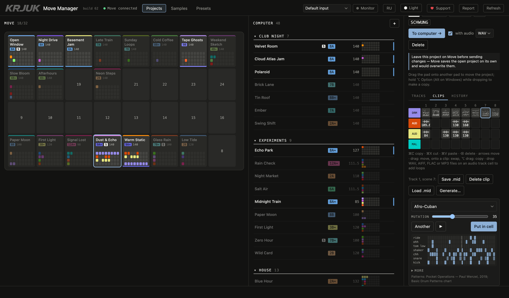
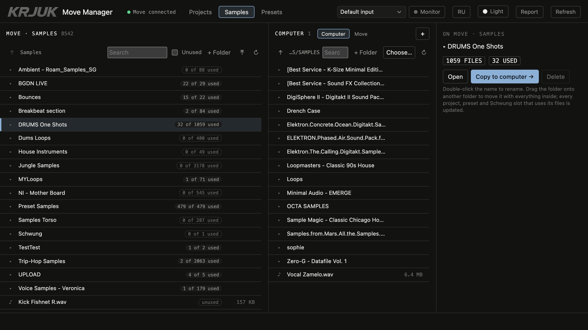

# KRJUK Move Manager


An app for managing Ableton Move projects, samples and presets right from your computer. It opens in your browser and connects to Move over Wi-Fi.

**Download:** [latest version](https://github.com/KrjukA/MoveManager/releases/latest) — at the bottom of the page, under Assets. How to install — [at the end of this page](#installation).

**Like it?** The app is free. You can support it here: (https://ko-fi.com/krjuk) — or with the Support button in the app.



## Projects

- Projects are shown just like on Move: a 4×8 grid with the same layout.
- Drag projects from the computer to Move and back, and move them from pad to pad on Move.
- On the computer, sort projects into groups, rename them and add a description and notes.
- See what's inside a project: tracks, instruments and presets, along with the folder they come from.

## Key and tempo

- Every project shows its key, scale and tempo.
- The Camelot wheel shows which projects go well together by key — handy for planning the order of a live set.
- Change key, tempo and name right from the manager.

## Listening

- When a project is saved, its audio is copied or recorded as WAV or MP3, so you can play a demo without Ableton.
- Monitor lets you listen to an input through the computer, for example Move over USB.

## Inside a project

- Reorder tracks.
- Load MIDI clips into a project's slots and export them.
- Copy, cut and paste clips (⌘C / ⌘X / ⌘V), delete them, move them between tracks and swap them.
- Load audio clips into audio track slots, move and delete them.



## Drum generator

- Creates drum clips in the style of different genres and can learn from your own MIDI clips.
- Knobs for mutation, ghost notes, euclidean rhythms and half time.
- Listen to the result before it goes into a cell.

## Samples and presets

- Move samples between the computer and Move in both directions.
- Tidy up your collection right on Move.
- Projects keep their sound when samples are moved or renamed.
- Find and delete samples that no project uses.



## Schwung support

- When copying projects, the manager takes devices from the Schwung background firmware into account.

## History and undo

- The last 20 changes of every project are kept.
- Go back to any version — and the restore itself can be undone too.

## Safety and comfort

- The app connects to Move with its own SSH key, which Move accepts only after you confirm it with the wheel.
- Dark and light themes.
- English and Russian interface.
- Works on Mac and Windows.

## Installation

Step-by-step guides: `KRJUK-Move-Manager-install-EN.txt` (English) and `KRJUK-Move-Manager-install-RU.txt` (Russian) on the [latest version](https://github.com/KrjukA/MoveManager/releases/latest) page.

1. Download the archive for your system:
   - Windows — `KRJUK-Move-Manager-<version>-windows.zip`;
   - Mac with Apple chip (M1 and newer) — `KRJUK-Move-Manager-<version>-mac-apple-silicon.zip`;
   - Mac with Intel — `KRJUK-Move-Manager-<version>-mac-intel.zip`.
2. Unzip it. On a Mac, drag the app into Applications.
3. First launch — the system warns that the developer is unknown (the app has no paid signature):
   - **Windows:** "Windows protected your PC" → More info → Run anyway.
   - **Mac (macOS 15 and newer):** open the app, close the warning, then
     System Settings → Privacy & Security → scroll down → **Open Anyway**.
   - **Mac (macOS 14 and older):** right-click the app → Open → Open.
   - **Mac says "can't be opened" and there is no Open Anyway button** — open Terminal
     (Applications → Utilities → Terminal), paste this line and press Enter:

     ```bash
     xattr -dr com.apple.quarantine "/Applications/KRJUK Move Manager.app"
     ```

     It only removes the "downloaded from the internet" mark.
4. A small "Move Manager is running" window opens, and the manager opens in your browser. Keep the small window open while you work; Quit closes the app.
5. Move must be on and on the same Wi-Fi network. The first time, enter the code shown on Move's screen.
   If Move isn't found, type its IP address (on Move: Settings → Wi-Fi); on a Mac, also allow the app under
   Privacy & Security → Local Network.

**Something went wrong?** Click **Report** at the top right, describe in a few words what you did and click Send report — it goes to the developer.

---

The drum generator's patterns come from the book [Pocket Operations](https://shittyrecording.studio/) (Paul Wenzel, 2019) and the Basic Drum Patterns chart.
MIT license — see [LICENSE](LICENSE). Ableton and Move are trademarks of Ableton AG; this project is not affiliated with Ableton.
For developers — [docs/DEVELOPMENT.md](docs/DEVELOPMENT.md).
